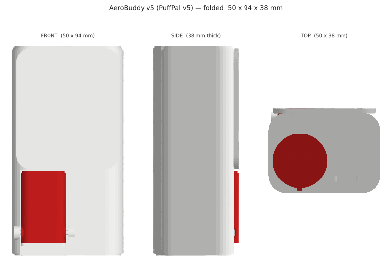
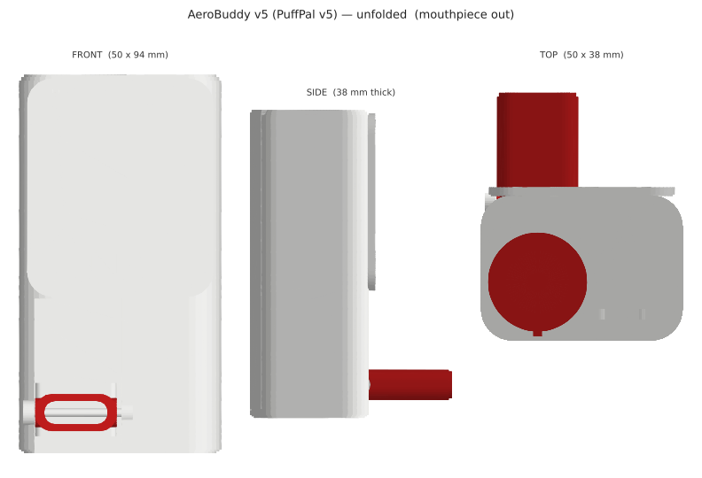

# AeroBuddy v5

**A folding inhaler companion — dose tracing, a little avatar, no app. By [TheCodersNook](https://github.com/TheCodersNook).**

*Developed as PuffPal — this is the v5 hardware (PuffPal v5 lineage).
Internal file names keep the `puffpal-v5` prefix.*

*Isometric renders of the real v5 geometry: folded (top) and unfolded with
the mouthpiece swung out (bottom). White shell, red mouthpiece and press
cap, 1.54" e-ink screen.*

## What it is

AeroBuddy v5 is a folding **replacement actuator** for an albuterol inhaler:
your bare canister drops into a printed body with a printed nozzle block, and
the whole thing folds flat into a rounded pebble slab that fits a 4" × 2" box.
A 1.54" e-ink screen shows a small avatar, your dose count, and doses left.
A microswitch counts every press. There is **no companion app, no account,
no subscription, and no cloud** — plug it into a computer over USB and the
dose log dumps as CSV over serial.

## At a glance

| | |
|---|---|
| Folded size (measured from the STLs) | **50.0 × 94.0 × 38.0 mm (1.97" × 3.70" × 1.50")** — fits a 4" × 2" box |
| Unfolded size (measured from the STLs) | **50.0 × 94.0 × 61.5 mm** |
| Printed parts | **7** (down from 11 in v4) |
| Screen | 1.54" 200×200 e-ink, GDEH0154D67 / GDEY0154D67 (27×27 mm active) |
| Brain | Seeed XIAO nRF52840 |
| Battery | 110 mAh LiPo (301230); ~13 months typical use, beacon off — ~4.5 months with the OpenHaystack beacon on (both modeled estimates, same as v4) |
| Dose sensing | 6×6×5 mm microswitch + cam rib on the press cap (same part as the UI button) |
| Mouthpiece | Folds flush into the body; flattened oval 20×9 mm, like an inhaler mouthpiece; rounded tip |
| Colour scheme | White shell + red accents (mouthpiece, press cap) + 15 mm red cross on the backplate |
| Weight | ~115–120 g assembled (estimated — about 2.3× a stock inhaler) |
| Print | PETG (white + red); combined plate 141.5 × 92.0 mm, fits a 220×220 mm bed |
| Firmware | PlatformIO + Arduino, compile-checked (RAM 8.2%, Flash 18.2%) — not hardware-tested |

## What changed vs v4

**Parts: 11 → 7.** Four parts (and their assemblies) are gone:

| Cut | Why |
|---|---|
| Reed sled + magnet boss + reed switch + magnet | Dose sensing is now a **6×6×5 mm tactile microswitch** in a pocket in the front bore wall, driven by a cam rib on the press cap. One cheap part, no magnet to align, no sled to position per can size — and it's the **same part as the UI button**, so one pack covers both. |
| 1 mm spacer shim | No longer needed — the nozzle pocket takes no shim. |
| Printed needle-orifice nozzle | **Transplant only now.** The needle variant changed the drug path and was experimental-only; one nozzle variant keeps the build simpler and the drug-delivery geometry stock. |
| Printed button cap | The UI button is pressed **directly through the faceplate hole** — no cap to print or align. |

**Kept as a separate part:** the **hinge pin** — a snap-fit pin would
weaken the hinge, so it stays a separate printed part (or a 27 mm length
of 1.75 mm filament).

**Also new in v5:**

- **Finger scoop** — a concave scoop printed into the top-front rim above
  the can bore, so the fingertip finds the press cap naturally. Nothing
  to assemble.
- **Sleeker shell** — rounded top and bottom rims (stepped round-overs),
  chamfered faceplate edge, rounded mouthpiece tip. Shell corner radius
  stays 8 mm.
- **Red cross + red-and-white scheme** — a 15 mm Greek-cross pocket, 1 mm
  deep, on the white backplate, filled with red paint or a red filament
  swap at that layer; mouthpiece and press cap print in red.
- **Microswitch dose sensing with a designed margin** — the cam rib (ramp
  + dwell flat) closes the switch ~1.4 mm into the ~3.2 mm fire stroke:
  **1.1 mm of margin** against the 2.5 mm minimum stroke, and the dwell
  flat holds it closed without blocking the stroke.

**Unchanged from v4:** folded/unfolded size, 1.54" screen, XIAO nRF52840,
110 mAh 301230 LiPo, USB-C charging + data, transplant nozzle, hinge,
board/battery bay, screw positions, battery estimates, and the OpenHaystack
Find My beacon firmware (reed→microswitch renames only).

## Features

- **Folds flat.** The mouthpiece swings flush into the body — no protruding
  tube when folded, no vape silhouette: a rounded pebble slab, not a pen.
- **Big screen.** The 1.54" e-ink fits the same 50 mm-wide body, portrait,
  with room to spare.
- **Dose tracing on-device.** Every press is counted and timestamped to
  flash; the screen shows doses left, today, and a 7-day bar view.
- **A little avatar.** Four faces (happy, sleepy, concerned, empty) that
  react only to device facts — kind, never shaming.
- **No app.** Nothing to install, no account, no server that can shut down
  and brick the device.
- **Find My tracking (OpenHaystack).** The firmware broadcasts a rotating
  public key as an Apple Offline Finding beacon, so any nearby iPhone can
  report the inhaler's location — no MFi, no Apple approval, no companion
  app. Keys are generated on your computer and provisioned over USB;
  locations appear in the fetch tool, never in Apple's Find My app. See
  `firmware/OPENHAYSTACK.md`. **Not hardware-tested yet** — bench
  verification still required.
- **Transplant nozzle.** Cut the stem block + nozzle out of your stock
  actuator and epoxy it into the printed block — the stock orifice, sump,
  and stem fit are preserved, so the drug-delivery geometry is unchanged.
  (The printed needle-orifice variant is gone in v5.)

## Quick start

1. **Measure your can with calipers first** — valve stack height, stem
   length, can diameter. Those numbers are estimates in the CAD; the
   nozzle block is not tolerant of guesses. See `docs/build-notes.md` §4.
2. **Print** — PETG recommended, white + red. `cad/puffpal-v5-combined.stl`
   lays all parts out on one 141.5 × 92.0 mm plate. Print settings in
   `docs/build-notes.md` §6.
3. **Transplant the nozzle** — cut the stem block out of your stock
   actuator, epoxy it into `puffpal-v5-nozzle-transplant.stl`.
4. **Assemble** — microswitch in the bore-wall pocket (plunger toward the
   can, wires to D6 + GND); hinge pin is a 27 mm length of 1.75 mm
   filament; M2 screws throughout. Full order in `docs/build-notes.md` §7.
5. **Flash the firmware** — `cd firmware && pio run -t upload`
   (Seeed XIAO nRF52840). Details + pinout in `firmware/README.md`.
6. **Validate before real use** — spray-pattern comparison against the
   stock actuator with an empty/water can first. See
   `docs/build-notes.md` §8.
7. **Tracking (optional)** — generate keys and provision the OpenHaystack
   beacon (see `firmware/OPENHAYSTACK.md` §4–§5); the screen shows
   `FIND MY ON` once keys are loaded.

## What's inside

| Path | What it is |
|---|---|
| `cad/` | All 10 v5 STLs: 7 parts + folded/unfolded assemblies + combined print plate. All watertight (verified with trimesh). |
| `firmware/` | PlatformIO + Arduino firmware for the XIAO nRF52840 + 1.54" e-ink, with a scripted 7-day dose-logic simulation + the OpenHaystack Find My beacon (`OPENHAYSTACK.md`, `tools/haystack_keys.py`). |
| `docs/` | `BOM.md` (Amazon-only parts list), `build-notes.md` (full build guide). |
| `images/` | Renders of the v5 geometry. |

## Parts (BOM)

About **$20.50 in parts** (planning anchors, not live prices — see
`docs/BOM.md` for the 16-line Amazon-only list with exact search terms
for every part: XIAO nRF52840, 1.54" e-ink panel + adapter, 110 mAh
LiPo, 6×6×5 mm tactile switches (dose + UI, one pack), LED, M2 screws,
white + red PETG filament, epoxy). No ASINs or prices are quoted as live —
verify each listing before buying.

## Firmware

Real firmware, in `firmware/` — PlatformIO + Arduino for the XIAO
nRF52840, GxEPD2 driving the 1.54" e-ink. Deep sleep between events
(System ON idle, RTC kept alive); wake on microswitch close (D6); 400 ms
debounce; avatar faces + dose count + doses left on screen; button cycles
today / 7-day bars / total; long-press + confirm resets for a new
canister; dose log in flash, dumped as CSV over USB serial.
**Compile-checked** (`pio run`: RAM 8.2%, Flash 18.2%) — **not
hardware-tested**. Same OpenHaystack Find My beacon as v4 (reed→microswitch
renames only): a rotating P-224 public key advertised over BLE (1 s
interval, key rotates every 15 min), keys provisioned over USB serial —
see `firmware/OPENHAYSTACK.md` for setup, battery cost (~4.5 months
beacon-on), and caveats. Locations appear in the fetch tool, never
in Apple's Find My app.

## Status — what still needs bench verification

- **Microswitch actuation on the real print** — the 1.4 mm close point and
  1.1 mm margin are designed values; the cam rib, pocket depth, and
  plunger travel need confirming on a printed body with a real switch.
  100 presses, zero missed/double, is the acceptance test.
- **Sleep-current measurement** — the battery months pivot on it
  (5 µA vs 1 mA is the difference between ~2 years and 4 days). Measure
  it, do not assume it.
- **Spray-pattern validation is required before real use** — even for the
  transplant variant. Compare against the stock actuator with an empty/water
  can first; keep the stock actuator as backup for the first week.
- **Find My bench checks** — scanner check (an Apple device hears the
  beacon), 15-min key rotation, first location report. The beacon compiles
  and the key/payload math checks out, but no Apple device has heard it
  yet.
- **Nothing has been printed or fit-tested yet.** The STLs are
  geometry-verified (all watertight, bboxes checked), but no part has been
  through a printer. First print is a fit test. The void checks were
  re-run against the v5 body (screen pocket, button pocket, LED cavity,
  FPC slot, and nozzle pilot slots all verified open by ray-cast — a
  sealed-pocket defect inherited from v4 was found and fixed in the
  CAD); the hinge-sweep check still needs re-running against the v5
  body geometry.
- **FPC exit edge:** the panel datasheet's mechanical drawing was a
  garbled scan — the design assumes the FPC exits the panel's short
  edge. Verify on receipt.
- **Hinge needs a 1,000-fold cycle test.** Drop/impact is unmodelled.

## Safety

**Personal prototype, not a medical device.** This is a replacement
actuator for your own albuterol inhaler, built for prototyping. It is
not tested, certified, or approved as a medical device. Do not give it
to anyone else, do not sell it, and do not trust it with a real dose
until you have validated it as described in `docs/build-notes.md` §8.
The transplant nozzle preserves the stock drug-delivery geometry.

The red cross emblem is a protected symbol under the Geneva Conventions
for official medical use — fine for a personal prototype, but a product
sold later would need a different medical mark (e.g. a green cross).

## License

MIT. Copyright (c) 2026 TheCodersNook.
