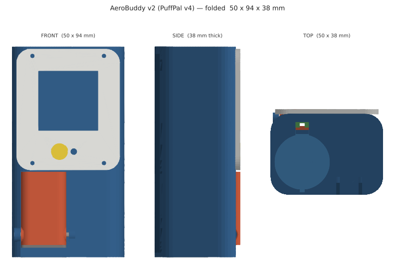
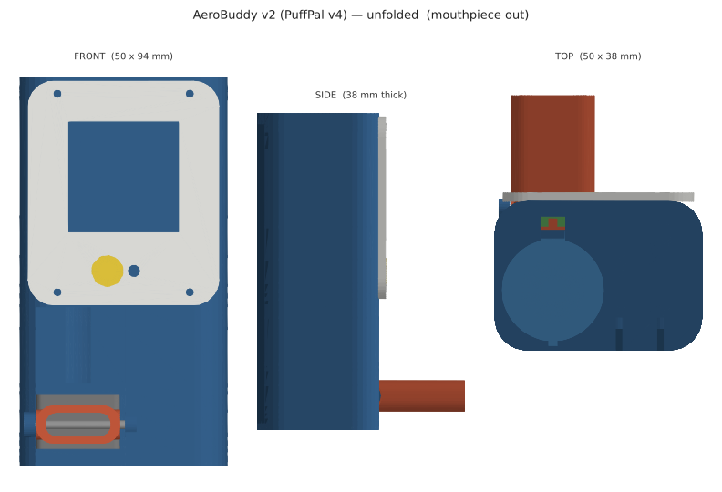

# AeroBuddy v2

**A folding inhaler companion — dose tracing, a little avatar, no app. By [TheCodersNook](https://github.com/TheCodersNook).**

*Developed as PuffPal — this is the v4 hardware (PuffPal v3/v4 lineage).
Internal file names keep the `puffpal-v4` prefix.*

*Three-view orthographic renders of the real v4 geometry: folded (top) and
unfolded with the mouthpiece swung out (bottom).*

## What it is

AeroBuddy v2 is a folding **replacement actuator** for an albuterol inhaler:
your bare canister drops into a printed body with a printed nozzle block, and
the whole thing folds flat into a rounded pebble slab that fits a 4" × 2" box.
A 1.54" e-ink screen shows a small avatar, your dose count, and doses left.
A reed switch counts every press. There is **no companion app, no account,
no subscription, and no cloud** — plug it into a computer over USB and the
dose log dumps as CSV over serial.

## At a glance

| | |
|---|---|
| Folded size (measured from the STLs) | **50.0 × 94.0 × 38.0 mm (1.97" × 3.70" × 1.50")** — fits a 4" × 2" box |
| Screen | 1.54" 200×200 e-ink, GDEH0154D67 / GDEY0154D67 (27×27 mm active) |
| Brain | Seeed XIAO nRF52840 |
| Battery | 110 mAh LiPo (301230); ~13 months typical use, beacon off — ~4.5 months with the OpenHaystack beacon on (both modeled estimates) |
| Dose sensing | Reed switch + magnet on the canister press |
| Mouthpiece | Folds flush into the body; flattened oval 20×9 mm, like an inhaler mouthpiece |
| Weight | ~115–120 g assembled (estimated — about 2.3× a stock inhaler) |
| Print | PETG; combined plate fits a 220×220 mm bed |
| Firmware | PlatformIO + Arduino, compile-checked (not hardware-tested) |

## Features

- **Folds flat.** The mouthpiece swings flush into the body — no protruding
  tube when folded, no vape silhouette: a rounded pebble slab, not a pen.
- **Big screen.** The 1.54" e-ink (up from 0.97" in v3) fits the same
  50 mm-wide body, portrait, with room to spare.
- **Dose tracing on-device.** Every press is counted and timestamped to
  flash; the screen shows doses left, today, and a 7-day bar view.
- **A little avatar.** Four faces (happy, sleepy, concerned, empty) that
  react only to device facts — kind, never shaming.
- **No app.** Nothing to install, no account, no server that can shut down
  and brick the device.
- **Find My tracking (OpenHaystack).** The firmware broadcasts a rotating
  public key as an Apple Offline Finding beacon, so any nearby iPhone can
  report the inhaler's location — no MFi, no Apple approval, no companion
  app. Keys are generated on your computer and provisioned over USB;
  locations appear in the fetch tool, never in Apple's Find My app. See
  `firmware/OPENHAYSTACK.md`. **Not hardware-tested yet** — bench
  verification still required.
- **Transplant nozzle (recommended).** Cut the stem block + nozzle out of
  your stock actuator and epoxy it into the printed block — the stock
  orifice, sump, and stem fit are preserved, so the drug-delivery geometry
  is unchanged. A printed needle-orifice variant is included as
  experimental-only.

## Quick start

1. **Measure your can with calipers first** — valve stack height, stem
   length, can diameter. Those numbers are estimates in the CAD; the
   nozzle block is not tolerant of guesses. See `docs/build-notes.md` §4.
2. **Print** — PETG recommended. `cad/puffpal-v4-combined.stl` lays all
   parts out on one 202.5 × 97.5 mm plate. Print settings in
   `docs/build-notes.md`.
3. **Transplant the nozzle** — cut the stem block out of your stock
   actuator, epoxy it into `puffpal-v4-nozzle-transplant.stl`.
4. **Assemble** — hinge pin is a 27 mm length of 1.75 mm filament; M2
   screws throughout. Full order in `docs/build-notes.md` §6.
5. **Flash the firmware** — `cd firmware && pio run -t upload`
   (Seeed XIAO nRF52840). Details + pinout in `firmware/README.md`.
6. **Validate before real use** — spray-pattern comparison against the
   stock actuator with an empty/water can first. See
   `docs/build-notes.md` §8.
7. **Tracking (optional)** — generate keys and provision the OpenHaystack
   beacon (see `firmware/OPENHAYSTACK.md` §4–§5); the screen shows
   `FIND MY ON` once keys are loaded.

## What's inside

| Path | What it is |
|---|---|
| `cad/` | All 14 v4 STLs (**ASCII** — every slicer reads them, and they diff on GitHub): 11 parts + folded/unfolded assemblies + combined print plate. All watertight, verified with trimesh. |
| `firmware/` | PlatformIO + Arduino firmware for the XIAO nRF52840 + 1.54" e-ink, with a scripted 7-day dose-logic simulation (10/10 pass) + the OpenHaystack Find My beacon (`OPENHAYSTACK.md`, `tools/haystack_keys.py`). |
| `docs/` | `BOM.md` (Amazon-only parts list), `build-notes.md` (full build guide). |
| `images/` | SVG orthographic renders (folded + unfolded) — the images above. |
| `LICENSE` | MIT. |

## Parts (BOM)

About **$21 in parts** (planning anchors, not live prices — see
`docs/BOM.md` for the 17-line Amazon-only list with exact search terms
for every part: XIAO nRF52840, 1.54" e-ink panel + adapter, 110 mAh
LiPo, reed switch + magnet, button, LED, M2 screws, PETG filament,
epoxy). No ASINs or prices are quoted as live — verify each listing
before buying.

## Firmware

Real firmware, in `firmware/` — PlatformIO + Arduino for the XIAO
nRF52840, GxEPD2 driving the 1.54" e-ink. Deep sleep between events
(System ON idle, RTC kept alive); wake on reed close; 400 ms debounce;
avatar faces + dose count + doses left on screen; button cycles
today / 7-day bars / total; long-press + confirm resets for a new
canister; dose log in flash, dumped as CSV over USB serial.
**Compile-checked** (`pio run`: RAM 8.2%, Flash 18.2%) — **not
hardware-tested**. It also runs an **OpenHaystack Find My beacon**: a
rotating P-224 public key advertised over BLE (1 s interval, key
rotates every 15 min), keys provisioned over USB serial — see
`firmware/OPENHAYSTACK.md` for setup, battery cost (~4.5 months
beacon-on), and caveats. Locations appear in the fetch tool, never
in Apple's Find My app. A scripted 7-day
dose-logic simulation passes 10/10 cases (bounce, rapid presses,
midnight rollover, reset) — see `firmware/sim/results.md`.

## Status — what is NOT yet verified

- **Nothing has been printed or fit-tested yet.** The STLs are
  geometry-verified (all watertight, hinge sweep collision-free,
  clearances checked numerically), but no part has been through a
  printer. First print is a fit test.
- **FPC exit edge:** the panel datasheet's mechanical drawing was a
  garbled scan — the design assumes the FPC exits the panel's short
  edge. Verify on receipt.
- **Sleep current is unmeasured** — the battery months pivot on it
  (5 µA vs 1 mA is the difference between ~2 years and 4 days).
- **Spray-pattern validation is required before real use** — even for
  the transplant variant. Compare against the stock actuator with an
  empty/water can first; keep the stock actuator as backup for the
  first week.
- **Hinge needs a 1,000-fold cycle test.** Drop/impact is unmodelled.
- **Find My beacon is unproven on air.** The OpenHaystack beacon compiles
  and the key/payload math checks out, but no Apple device has heard it
  yet. Bench verification (scanner check, 15-min rotation, first report)
  is still required — see `firmware/OPENHAYSTACK.md` §6.

## Safety

**Personal prototype, not a medical device.** This is a replacement
actuator for your own albuterol inhaler, built for prototyping. It is
not tested, certified, or approved as a medical device. Do not give it
to anyone else, do not sell it, and do not trust it with a real dose
until you have validated it as described in `docs/build-notes.md` §8.
The transplant nozzle variant preserves the stock drug-delivery
geometry; the printed needle-orifice variant changes it and is
experimental-only.

## License

MIT — see [LICENSE](LICENSE). Copyright (c) 2026 TheCodersNook.
